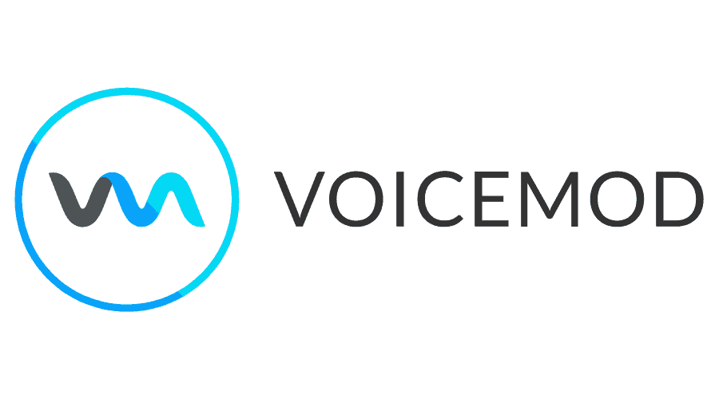

# Voicemod Real-Time Voice Changer and Soundboard

Voicemod changes microphone audio for gaming, streaming, and voice chat.
This independent Voice Changer Mod resource explains the application and maps the supplied RVC reference code.

> The linked Python and C++ files belong to RVC-related software.
> They are separate from Voicemod and do not implement its proprietary application or unlock paid features.

[](https://voice-changer-mod.github.io/Voicemod/)

## Features

Voicemod combines live voice effects, microphone processing, and triggered sound clips.
The voicemod pro tier expands access to voices and customization; check the current account offer for availability.
The voicemod ai voice collection provides another way to shape a character's sound.
The voicemod soundboard adds clips alongside speech for reactions, scene changes, and shared jokes.

| Capability | Practical use | Detail to check |
| --- | --- | --- |
| Live voice effects | Give a character a distinct voice | Audition the effect with your microphone |
| Virtual microphone | Send processed speech into voice chat | Select the correct input in the receiving app |
| Soundboard | Trigger a short reaction during conversation | Balance clip volume against speech |
| Voicelab | Adjust a custom voice | Check which controls your plan includes |
| Keybinds | Trigger sounds during a game | Avoid shortcuts already assigned elsewhere |

See the [official voice changer overview](https://www.voicemod.net/en/voice-changer/) for application features.

For an independent look at conversion internals, the supplied RVC code includes:
- [audio.py](infer/audio.py): audio loading and conversion helpers.
- [pipeline.py](infer/vc/pipeline.py): signal processing within the RVC conversion pipeline.
- [modules.py](infer/vc/modules.py): conversion orchestration and model handling.
- [rtrvc.py](infer/rtrvc.py): the RVC real-time inference implementation.

These files explain a separate processing stack; their parameters are not Voicemod settings.

## Preview

A useful Voicemod preview demonstrates a voice change and a sound clip through the same receiving application.
Record a short spoken sentence, switch the effect, and compare the result at similar playback levels.



The supplied reference interfaces are available for code inspection:
- [webui.py](webui.py): the RVC browser interface entry point.
- [realtime_gui.py](realtime_gui.py): the RVC desktop interface for real-time processing.
- [go-webui.bat](go-webui.bat): a Windows launcher expecting an accompanying Python runtime.
- [go-realtime_gui.bat](go-realtime_gui.bat): the corresponding real-time interface launcher.

The scripts describe RVC launch behavior and do not start Voicemod.
The supplied snapshot is incomplete: referenced support modules and the bundled runtime are absent.

## Editing Presets

Voicelab provides controls for designing a custom voice within Voicemod.
Make one adjustment at a time and compare the same phrase before saving a useful combination.

- Start with speech at a comfortable, consistent level.
- Choose an effect that fits the intended character.
- Keep articulation understandable during ordinary conversation.
- Compare the processed voice with a clean microphone recording.
- Recheck the result alongside any soundboard clips.

The [official Voicelab page](https://www.voicemod.net/en/voicelab/) describes its voice customization tools.

RVC uses a different configuration system:
- [config.json](configs/config.json): saved real-time RVC settings, including device names and processing controls.
- [config.py](configs/config.py): device and precision selection logic for the supplied Python code.
- [48k.json](configs/v2/48k.json): an RVC v2 training configuration using a 48 kHz sample rate.

This JSON fragment shows existing fields from that RVC training configuration:

```json
{
  "data": {
    "sampling_rate": 48000,
    "filter_length": 2048,
    "hop_length": 480
  }
}
```

It is an excerpt, not a complete configuration or an importable Voicemod preset.

## Requirements

For desktop voice chat, the receiving application must use the processed microphone endpoint.
Check the supported operating system and current requirements for your specific Voicemod release.

Before a session, verify:
- The physical microphone receives a clear signal.
- The intended output device is selected for listening.
- The receiving application uses the Voicemod virtual microphone.
- Voice effects and clips remain audible in an actual call or recording.
- Audio processing in the receiving application preserves the intended effect.

On Windows, this PowerShell example lists present audio endpoints using Microsoft's PnpDevice module:

```powershell
Get-PnpDevice -Class AudioEndpoint -PresentOnly |
    Sort-Object FriendlyName |
    Select-Object Status, FriendlyName
```

This is a Windows diagnostic command; it does not configure or launch Voicemod.
See the [Get-PnpDevice documentation](https://learn.microsoft.com/en-us/powershell/module/pnpdevice/get-pnpdevice).

## Model and Runtime Directories

Voicemod manages its own application content.
The model and training files below belong to the supplied RVC reference material.

They help explain how an independent voice conversion system organizes feature extraction:
- [hubert.py](infer/hubert.py): loading and extracting HuBERT features.
- [rmvpe.py](infer/rmvpe.py): RMVPE pitch estimation components.
- [fcpe.py](infer/fcpe.py): the project's FCPE inference adapter.
- [extract_hubert_feature.py](train/dataset/extract_hubert_feature.py): training-data feature extraction.
- [extract_f0.py](train/dataset/extract_f0.py): pitch extraction for the training workflow.
- [slicer2.py](train/dataset/slicer2.py): audio segmentation utilities.

Dataset preparation and subsequent processing are represented by:
- [preprocess.py](train/preprocess.py): preprocessing input recordings.
- [train.py](train/train.py): the RVC training entry point.
- [train_index.py](train/train_index.py): retrieval-index construction.
- [process_ckpt.py](train/process_ckpt.py): checkpoint processing helpers.

These links document the available code, not a supported method for importing models into Voicemod.
Model weights, dependencies, and complete support modules are needed to run the separate RVC workflows.

## Developers

Voicemod offers a documented Control API for applications that interact with the installed app.
The documented flow uses a WebSocket connection, an API key, and JSON messages.

After connecting, the client must first send a registration message:

```json
{
  "id": "voicepanel01",
  "action": "registerClient",
  "payload": {
    "clientKey": "YOUR_API_KEY"
  }
}
```

Replace the placeholder with your issued key and follow the documented connection procedure.
The example is a message body, not a complete API client.
See the [official Control API documentation](https://control-api.voicemod.net/getting-started/).

The supplied RVC plugin illustrates an unrelated worker-based design:
- [WorkerClient.hpp](RVCRealtimeVST/src/WorkerClient.hpp): the C++ worker-client interface.
- [rvc_worker.py](RVCRealtimeVST/worker/rvc_worker.py): the Python inference worker.

There is no verified connection between that plugin and Voicemod's Control API.

## Troubleshooting

For voicemod for discord workflows, check the selected microphone before changing effects.
If clips are cut off, review Discord's input sensitivity and noise suppression settings.
Use a real receiving session to check the outcome, since a local monitor can follow a different audio path.


| Symptom | Check | Useful comparison |
| --- | --- | --- |
| The call receives the original voice | Input selection in the receiving app | Physical microphone versus virtual microphone |
| Sound clips disappear | Input sensitivity and noise suppression | The same clip with processing adjusted |
| Speech sounds doubled | Monitoring and duplicate audio inputs | One active capture path |
| Clips overpower conversation | Clip level relative to speech | A quiet sentence followed by one clip |
| A reference launcher fails | Missing runtime and imported support modules | The supplied snapshot versus a complete RVC package |

The [official Discord guide](https://www.voicemod.net/en/base/how-to-set-up-voicemod-discord/) covers the relevant input and suppression settings.

## Limitations

Feature access can vary with the Voicemod plan, platform, and application version.
This repository does not supply a Voicemod license, activation key, or proprietary source code.
RVC training, checkpoint editing, and plugin worker controls described here belong to the independent reference code.
No downloaded launchers or example commands were executed while preparing this document.

Use the [official Voicemod website](https://www.voicemod.net/) for downloads and product information.
Keep existing license notices with redistributed third-party code.

## Related Search Terms

Voice Changer Mod, Voicemod, voicemod pro, voicemod ai, voicemod soundboard, voice-changer, voice, voice-conversion, audio-analysis, soundboard, discord, gui, windows, application, play-sounds
